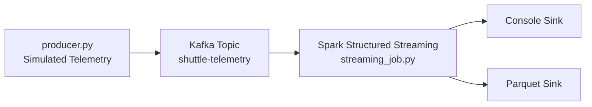

# Space Shuttle Telemetry Streaming

Real-time telemetry pipeline for Space Shuttle-style flight data using **Apache Kafka** + **Spark Structured Streaming**. The producer simulates shuttle sensors, Kafka buffers the stream, and Spark parses, validates, aggregates, and writes windowed metrics to Parquet and the console.

> All telemetry in this repo is **simulated**. It is modeled on public NASA-style shuttle telemetry fields (velocity, altitude, fuel, cabin pressure, temperatures) for learning and portfolio purposes — no real flight data is included.

## Architecture

```
Simulated Shuttle Sensors
        |
        v
  [producer.py] --JSON--> [Kafka: shuttle-telemetry]
                                |
                                v
                    [Spark Structured Streaming]
                    - Parse JSON + schema validation
                    - Watermark + 1-min tumbling windows
                    - Avg / max velocity, altitude, temp
                    - Anomaly flagging
                                |
                +---------------+---------------+
                v                               v
        Console (dev)                  Parquet (data/output/)
```



## Tech Stack

| Layer | Tool |
|---|---|
| Streaming | Apache Spark 3.5 (Structured Streaming) |
| Messaging | Apache Kafka 3.6 + Zookeeper / KRaft-ready |
| Language | Python 3.10+ (PySpark, kafka-python) |
| Storage | Parquet (local / S3-compatible path) |
| Orchestration (local) | Docker Compose |
| Analysis | Jupyter |

## Project Structure

```
space-shuttle-telemetry-streaming/
├── README.md
├── requirements.txt
├── docker-compose.yml
├── .gitignore
├── src/
│   ├── config.py          # Shared settings (topics, brokers, windows)
│   ├── producer.py         # Simulated telemetry generator -> Kafka
│   └── streaming_job.py    # Spark Structured Streaming job
└── notebooks/
    └── exploration.ipynb   # Sample batch analysis of Parquet output
```

## Quickstart

### 1. Start Kafka + Spark (Docker)

```bash
docker compose up -d
docker compose ps
```

This starts Zookeeper, Kafka (port `9092`), and a Spark master/worker for local dev.

### 2. Install Python deps

```bash
python -m venv .venv
source .venv/bin/activate
pip install -r requirements.txt
```

### 3. Start the producer

In one terminal:

```bash
python src/producer.py --rate 2 --duration 120
# --rate: messages per second per sensor batch
# --duration: seconds to run (omit for infinite)
```

Sample message:

```json
{
  "mission": "STS-SIM-01",
  "timestamp": "2026-10-14T15:30:00Z",
  "velocity_kms": 7.8,
  "altitude_km": 320.5,
  "fuel_pct": 64.2,
  "cabin_pressure_kpa": 101.3,
  "engine_temp_c": 1250.0,
  "o2_pct": 21.0,
  "status": "NOMINAL"
}
```

### 4. Run the Spark streaming job

In another terminal:

```bash
spark-submit \
  --packages org.apache.spark:spark-sql-kafka-0-10_2.12:3.5.0 \
  src/streaming_job.py
```

You should see windowed aggregations in the console and Parquet files under `data/output/shuttle_metrics/`.

## Sample Output

```
-------------------------------------------
Batch: 12
-------------------------------------------
+-------------------+------------------+----------+----------+---------------+
|window             |avg_velocity_kms  |max_alt_km|avg_temp_c|anomaly_count  |
+-------------------+------------------+----------+----------+---------------+
|{2026-10-14 15:30,  |7.81              |322.1     |1248.5    |0              |
| 2026-10-14 15:31}  |                  |          |          |               |
+-------------------+------------------+----------+----------+---------------+
```

## Data Model

| Field | Type | Notes |
|---|---|---|
| `mission` | string | e.g. `STS-SIM-01` |
| `timestamp` | timestamp | Event time, UTC |
| `velocity_kms` | double | Orbital velocity, km/s |
| `altitude_km` | double | Altitude above sea level |
| `fuel_pct` | double | Remaining fuel % |
| `cabin_pressure_kpa` | double | Cabin pressure |
| `engine_temp_c` | double | Main engine temp |
| `o2_pct` | double | Cabin O2 % |
| `status` | string | `NOMINAL`, `WARNING`, `CRITICAL` |

### Anomaly Rules (in `streaming_job.py`)

- `engine_temp_c > 1400` → `CRITICAL`
- `fuel_pct < 15` or `cabin_pressure_kpa < 95` → `WARNING`
- Otherwise `NOMINAL`

These are simple demo thresholds — tune them in `src/config.py`.

## Configuration

Edit `src/config.py` or set env vars:

| Env Var | Default | Description |
|---|---|---|
| `KAFKA_BOOTSTRAP` | `localhost:9092` | Kafka bootstrap servers |
| `KAFKA_TOPIC` | `shuttle-telemetry` | Input topic |
| `OUTPUT_PATH` | `data/output/shuttle_metrics` | Parquet sink |
| `CHECKPOINT_PATH` | `data/checkpoint/shuttle` | Streaming checkpoint |
| `WINDOW_DURATION` | `1 minute` | Tumbling window |

## Notebook

`notebooks/exploration.ipynb` loads a Parquet sample and plots velocity vs. altitude and temperature over time. Great for a quick sanity check after a run.

## Future Work

- [ ] Add Delta Lake + time travel for output
- [ ] Add Prometheus / Grafana dashboards for live metrics
- [ ] Add AWS MSK + S3 variant (see sibling repo `realtime-kafka-msk-spark-pipeline`)
- [ ] Add dead-letter queue for malformed JSON
- [ ] Add unit tests with `pytest` + Spark local session

## License

MIT — free to use for learning and portfolio demos.
